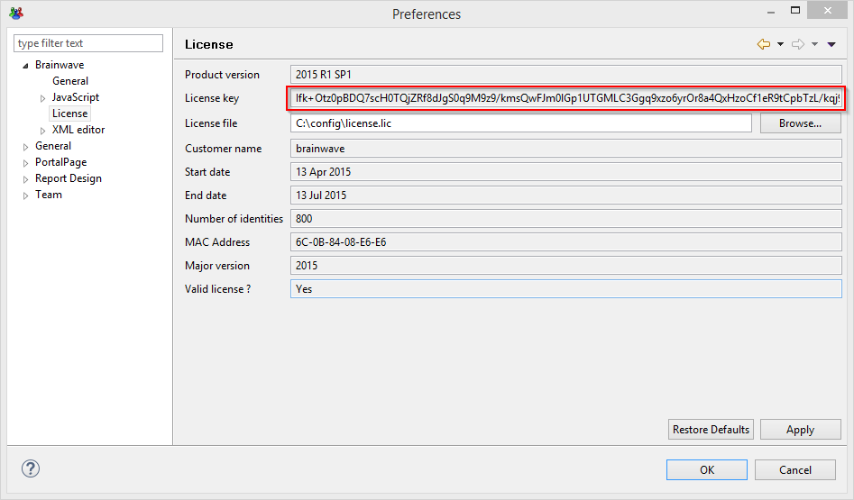

# iGRCanalytics Downloads

## Warning

### Dependencies

> [!warning] Descartes by default **requires** the use of IAP version **1.8 or higher**!  
> For more information, check the [release overview](../../iap-3.2/identity-analytics/iap-release/01-iap-release-overview.md) guide.  
> If you have questions about the compatibility of your version of Identity Analytics, contact the Radiant Logic support team.

### Database migration

> [!note] If you are migrating from a version of the product prior to **Curie R3** see [**here**](../igrc-platform/installation-and-deployment/07-database/04-schema-35-upgrade-procedure/index.md) for the detailed procedure.

## Descartes R6

Descartes R6 is the latest release of iGRCanalytics. For a complete list of changes, see the [release notes](./08-release-notes-descartes-r6.md).

Download the installers from the [Radiant Logic file sharing site](https://files.radiantlogic.com/receive/?packageCode=IX0qTSRyilShjhpxusLWpUDzzb4rduq2tO9F81NhEt4). After signing in, go to Home > Customer Downloads > Installers > IDA.

If you do not have access, contact [support@radiantlogic.com](mailto:support@radiantlogic.com).

After downloading an installer, [verify its integrity](#verify-download-integrity).

> [!note]
> Identity Analytics is not supported on Linux.
>
> Use Linux deployments only to automate data loading in Batch mode or to deploy the web application. Perform all configuration through iGRCanalytics in a Microsoft Windows environment.

For additional version and environment information, see:

- [Archived versions](03-archived-version)
- [Certified operating environments for iGRCanalytics](../igrc-platform/installation-and-deployment/04-brainwave-grc-certified-environments.md)
- [Product lifecycle and end-of-support dates](02-product-lifecycle)

## Add-ons (facets)

The Marketplace website (marketplace.radiantlogic.com) is currently offline. Add-ons (facets), including the IAP add-on (`bw_ias`) and data extractors, are available on the [Radiant Logic file sharing site](https://files.radiantlogic.com/receive/?packageCode=IX0qTSRyilShjhpxusLWpUDzzb4rduq2tO9F81NhEt4&directoryId=286e17e8-1c13-4d04-bea3-a37c4846939a#keycode=Niad1bODfyRmdW8PlGO-5In0mdRKsa0u6551qXXI1rA), in the same workspace as the product installers.

To request access, contact [support@radiantlogic.com](mailto:support@radiantlogic.com).

## Request a license key

Sign in to your [Radiant Logic support account](https://support.radiantlogic.com) and complete the "Request a license" form.

Copy the challenge from the product's "License key" field, shown in the following screenshot, and paste it into the request form. For details, see [iGRCanalytics license requests](https://support.radiantlogic.com/hc/en-us/articles/17805187130516-iGRCanalytics-licence-requests).



## Verify download integrity

Download the `.sha1` checksum file associated with your installer. This file contains the expected SHA-1 hash.

For example, the following installer:

```text
iGRCAnalyticsSetup_win32_x64_Descartes-R5-SP3_2024-12-09.exe
```

has this associated checksum file:

```text
iGRCAnalyticsSetup_win32_x64_Descartes-R5-SP3_2024-12-09.sha1
```

Calculate the SHA-1 hash of the downloaded installer using one of the methods below. The result must match the hash in the `.sha1` file exactly.

The examples below use a Descartes R5 SP3 installer. Replace the filename with the name of your downloaded installer.

### Windows

#### PowerShell

Use the `Get-FileHash` cmdlet with the SHA-1 algorithm:

```powershell
Get-FileHash -Path .\iGRCAnalyticsSetup_win32_x64_Descartes-R5-SP3_2024-12-09.exe -Algorithm SHA1
```

For details, see the [Get-FileHash documentation](https://docs.microsoft.com/en-us/powershell/module/microsoft.powershell.utility/get-filehash?view=powershell-6).

#### Certutil

Use the `certutil` command-line tool:

```shell
certutil -hashfile iGRCAnalyticsSetup_win32_x64_Descartes-R5-SP3_2024-12-09.exe SHA1
```

#### Microsoft File Checksum Integrity Verifier

You can also use the [Microsoft File Checksum Integrity Verifier](https://www.microsoft.com/en-us/download/details.aspx?id=11533):

```shell
fciv.exe -sha1 iGRCAnalyticsSetup_win32_x64_Descartes-R5-SP3_2024-12-09.exe
```

### Unix/Linux

Most Unix-like operating systems include `shasum`, `sha1sum`, or both. Use either command to calculate the hash:

```shell
shasum iGRCAnalyticsSetup_win32_x64_Descartes-R5-SP3_2024-12-09.exe
```

```shell
sha1sum iGRCAnalyticsSetup_win32_x64_Descartes-R5-SP3_2024-12-09.exe
```

To verify the installer directly against its checksum file, run:

```shell
shasum -c iGRCAnalyticsSetup_win32_x64_Descartes-R5-SP3_2024-12-09.sha1
```

## Database drivers

The Oracle and Microsoft SQL Server drivers are not included in the installation bundle for legal reasons. For download and installation instructions, see:

- [Install and use the official Microsoft SQL Server driver](../how-to/database/sqlserver/install-sqlserver-driver)
- [Install and use the official Oracle database driver](../how-to/database/oracle/install-orcl-driver)


