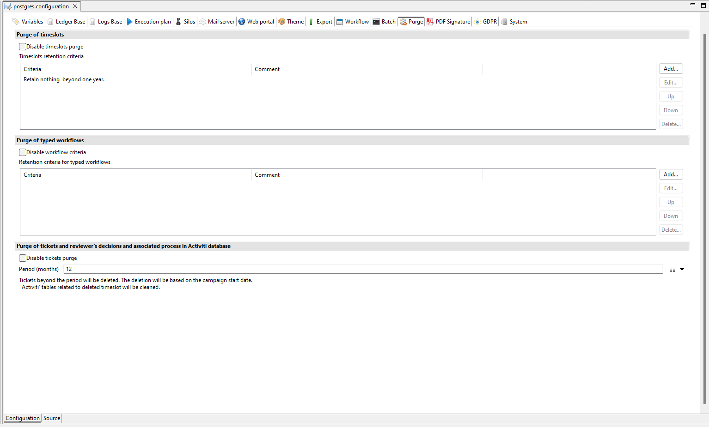
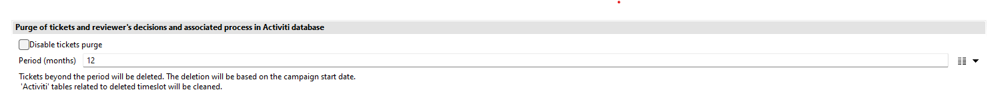

# How to purge tickets and activiti data

The purge of tickets and activiti data is only possible with the advanced purge using the technical configuration, under the purge tab in the igrc studio.

## Activiti

To purge activiti, 'Disable tickets purge' should be unchecked. During the purge, activiti data related to a deleted timeslot will be cleared.

## Tickets

To purge tickets, clear (uncheck) the "Disable tickets purge" checkbox. Select the retention period, in months, in the technical configuration. Every ticket created beyond the retention date will be deleted. The date used is based on the campaign start date. To delete a ticket, all three criteria must be met:

- The ticket's creation date must be beyond the retention period.
- The ticket must be related to a deleted timeslot.
- The ticket must not be related to an existing campaign.

> The retention period defines what you keep, not what you delete.

> [!warning] Since IDA 3.8, the ticket purge also deletes tickets for Identity Analytics review campaigns (campaign instances) that match the criteria above. Once purged, these campaign instances are no longer available from the portal: their history, details pages, and compliance reports can no longer be accessed. Campaign configurations are retained and can still be launched. Download the compliance reports for any campaigns you need to keep before running the purge.

## Launch Purge

See [Advanced Purge](../../igrc-platform/timeslots-and-execution-plan/02-purge-of-timeslots.md) for additional details. 
