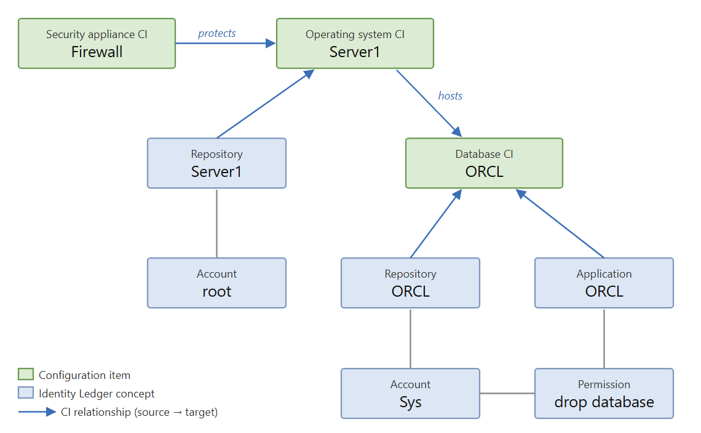
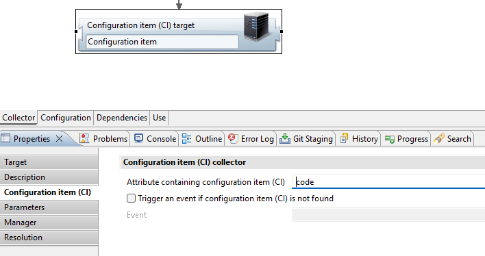
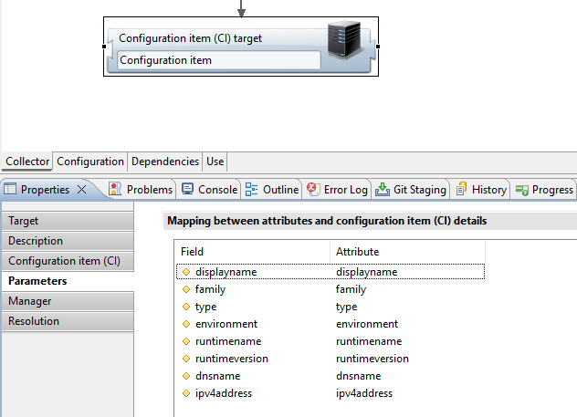
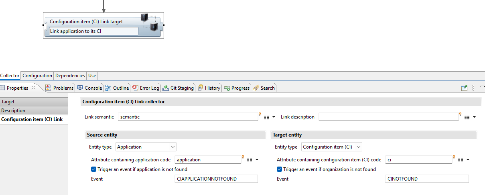
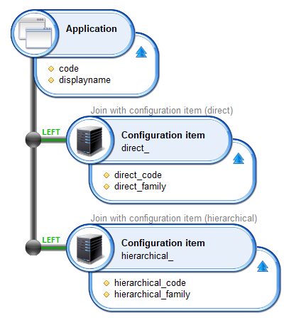
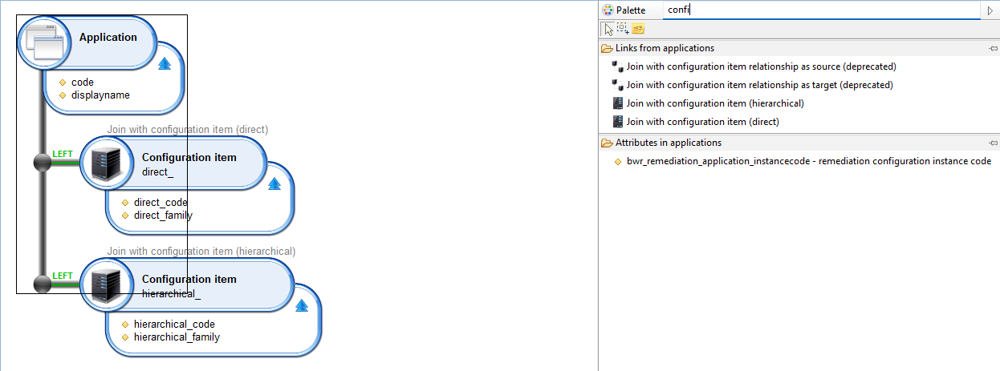
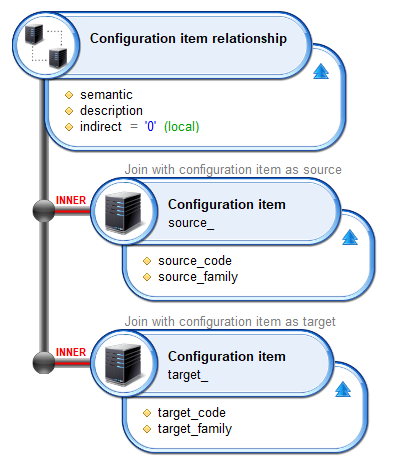
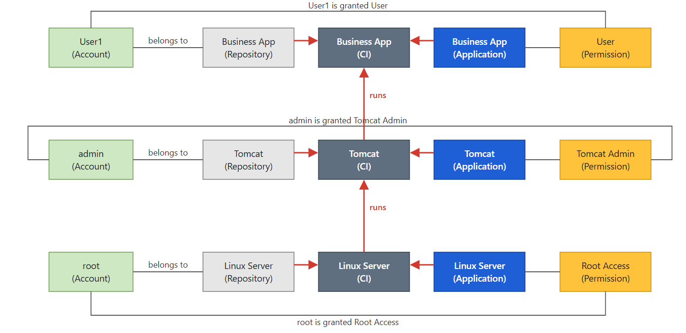

# Configuration items (CI)

## Introduction

A **configuration item (CI)** is an item of your IT infrastructure, as stored in a [CMDB](https://en.wikipedia.org/wiki/Configuration_management_database): a server, a database, a web server, a file share, a network component, etc.

Configuration items let you link the technical infrastructure to the applications it runs. With these links, you can see all the accesses that have an impact on an application:

- the accesses to the application itself,
- the accesses to the infrastructure elements that host the application (web server, database, server...).

In the Identity Ledger:

- a CI is a concept of its own, with its own attributes, managers and metadata,
- a **CI relationship** (CI link) links an Identity Ledger concept (application, repository, organization...) or another CI to a CI,
- CI relationships are **oriented**: from a **source** to a **target**. The target is a CI.

> [!note]
> To load the CIs of a ServiceNow CMDB, see [CMDB Configuration Items Data Correlation](../../../iap-3.8/identity-analytics/integration-guide/09-cmdb/). This page describes the CI concept itself and how to load your own CIs with a collector.

## Collect

Two targets are available in the collector editor:

- **Configuration item (CI) target**: creates a CI,
- **Configuration item (CI) link target**: creates a relationship between a concept or a CI and a CI.

### Configuration item (CI) target

 target")

#### Configuration item (CI) tab

Set the attribute containing the **configuration item key** (mandatory, mono-valued). This key identifies the CI: it must be unique among all the CIs.

You can also trigger an event if the configuration item (CI) is not found.

#### Parameters tab

Map the dataset attributes to the CI attributes:

| Attribute | Description |
|---|---|
| display name | Name shown in the pages |
| family | Category of the CI (for example `DB`, `SRV`, or the CMDB class such as `cmdb_ci_linux_server`) |
| type | More specific type of the CI |
| description | Description |
| environment | Environment (for example Production, QA) |
| address, details | Free values |
| DN, canonical name | Directory names of the CI |
| country code | Country code |
| runtime name, runtime version | Runtime of the CI (for example Tomcat, 10.1) |
| DNS name, IPv4 address, IPv6 address | Network names and addresses |
| enabled flag, state | Status of the CI |
| architecture, number of CPU threads, memory size, allocated storage, encrypted storage flag | Hardware information |
| URN | Uniform resource name |
| critical object flag | Marks a critical CI |
| creation date, modification date | Dates from the source system |
| password not required, password never expires, password expired, logon count, last logon date, bad logon count, last bad password date, password last set date | Account-like information, when the CI is an object with credentials |

Family and type are free values. Use the same values in all your collectors: views and pages filter on them.

> [!note]
> CIs have no custom attributes. Use [metadata](../metadata) to store more information on a CI.

#### Manager and Resolution tabs

As for applications or repositories, you can set the managers of a CI (manager HR code, expertise domain, delegation, dates...) and the rules used to find the manager identity when the HR code isn't available.

You can also set the managers of a CI with the [Manager target](../collector/04-components/target#manager-target), in its *Configuration item* mode.

### Configuration item (CI) link target

This target creates a relationship between a **source** and a **target**.

 link target")

The source can be:

- a configuration item,
- an application,
- a repository,
- an organization,
- an account,
- an identity.

The target is usually a **configuration item**. The same list of concepts is offered as target, and such links are loaded, but they are only visible through the *Configuration item relationship* concept in views: the indirect links, the parent / child CI joins and the direct / hierarchical joins only follow links whose target is a CI.

For each side, set the attribute containing the code of the entity (for an account: its login or identifier and its repository code) and whether to trigger an event when the entity isn't found.

You can also set:

- a **semantic**: the kind of relationship, for example `runs on`, `uses`, `hosted by`,
- a **description**.

#### Direction of the links

Load the links from **child to parent**: the source is the element that supports, the target is the element it supports. For example:

- the Linux server → the Tomcat server it hosts,
- the Tomcat server → the business application CI it runs,
- each Identity Analytics resource (application, repository) → its own CI.

This is the convention of the CMDB pages and of the ServiceNow CMDB connector (see [CMDB Configuration Items Data Correlation](../../../iap-3.8/identity-analytics/integration-guide/09-cmdb/)). With it, the hierarchical join of a resource returns all the CIs above it, and the page of a CI shows all the resources below it, so all the accesses that have an impact on it.

#### Indirect links

When the timeslot is activated, the indirect links are computed:

- **Application → CI** and **Repository → CI**: always computed. A repository linked to the CI of a Linux server, itself linked to a Tomcat CI, gets an indirect link to the Tomcat CI.
- **CI → CI**: not computed by default, for performance reasons. To compute them, start the batch with the Java option `-Dcompute_ci_indirect_link=true`. Use it only if your views need indirect links between CIs.

Indirect links don't depend on the CI family: any chain of links is followed.

## Views

The **Configuration item** and **Configuration item relationship** concepts are available in the view editor, as any other concept.

From a CI, you can join:

- its **parent** CIs (the sources of the links that target it) and its **child** CIs (the targets of the links it is the source of). With the child → parent convention, the *parent* join returns the CIs below, and the *child* join the CIs above,
- its relationships as source or as target,
- its managers and manager resolution rules,
- its metadata.

From an application or a repository, you can join its CIs:

- **Join with configuration item (direct)**: the CIs directly linked,
- **Join with configuration item (hierarchical)**: all the linked CIs, direct and indirect.

The *Join with configuration item relationship as source / as target (deprecated)* joins of applications and repositories are kept for older views. Use the direct and hierarchical joins instead.

From a relationship, you can join its source and target, and filter on the **Indirect relationship** attribute to keep only the direct links.

## Example: the access chain of an application

To see all the accesses that have an impact on an application, model each infrastructure element with:

- a **CI**,
- the **repository** of its accounts,
- an **application** for its permissions,

and link them.

For example, a business application runs on a Tomcat server, hosted on a Linux server:

- **User1** accesses the business application with the **User** permission,
- **admin** accesses the Tomcat server with the **Tomcat Admin** permission,
- **root** accesses the Linux server with the **Root Access** permission.

Load the links from child to parent:

- Linux server CI → Tomcat CI → business application CI,
- the Linux server repository → Linux server CI, the Tomcat application → Tomcat CI, the business application → business application CI.

The indirect links then link each resource to all the CIs above it. Starting from the business application CI, a view on applications or repositories with the hierarchical join (filtered on this CI) returns:

- the business application, and its accesses,
- the Tomcat server, and its accesses,
- the Linux server, and its accesses.

To show the whole chain in one place, build a business view that is the union of these accesses.

## Limitations

- CIs have no custom attributes and no localized attributes.
- No ticket review on a CI.
- Links whose target isn't a CI are only visible through the *Configuration item relationship* concept: they aren't followed by the indirect links and the CI joins.
