# Identity Analytics Data Model

## General principles

### Characterizing Identities

Access controls help identify inconsistencies between a person's role and their access to information systems. For example, only employees responsible for payroll should have access to payroll files in the HR system.

To support these controls, the Identity Analytics data model includes:

- Organizations
- Occupations
- Managerial relationships
- User status (such as employment dates, contract types, and areas of responsibility)

Organizations can also be linked to assets to represent their involvement in business processes.
Identity Analytics data model model supports a range of organizational structures, including hierarchical organizations, multiple hierarchies, matrix organizations, department-level management, direct reporting managerial relationships and more.

### Standardizing fine-grained access information

A control-oriented data model is very different from an authorization management data model, such as may be found for example in an identity management solution (IAM).

The main purpose of an identity management system is to help authorization managers handle their tasks more efficiently. To do this, these systems usually bundle permissions into groups, which are sometimes linked to each other and given business meaning (often called technical roles and occupational roles). From an identity management point of view, the chain works like this:

A user holds Occupational Roles. Those roles grant Technical Roles, and the Technical Roles grant permissions on the target systems. For technical reasons, identity management systems usually don’t handle fine-grained permissions. They only assign user accounts to user groups in the target systems automatically. Assigning fine-grained permissions to those groups is still the job of each application’s technical administrator.

This model works well for day-to-day authorization management. It falls short when it comes to access control and compliance.

Auditors care most about the fine-grained transactions. Their job is to find out whether business rights have been granted inappropriately in the systems. For example, can one person both change a client’s IBAN and send payments to that same client? Can a junior account manager sign contracts worth more than $1 million?

To find out, auditors first have to look at the fine-grained rights stored in the systems and answer the question “Who is allowed to…?” Only after that do groups and roles become relevant, because they answer the next question: “Why is this person allowed to…?” This analysis has to cover every system in the enterprise, since a key business process usually depends on several applications working together.

So for a control model, the chain runs in this manner: A user has several accounts. Those accounts allow fine-grained transactions on the systems, and the user has those rights because of the roles and profiles assigned in the authorization model.

The Identity Analytics data model is built on this approach. It does three things:

It loads fine-grained permissions first, from every kind of IT system: applications, file servers, physical access systems, ECM systems and so on.
It puts the fine-grained permissions from these different systems on the same level. This makes it possible to run controls that combine business transactions, access to shared folders, physical access and more. To get there, permissions are “unpacked” to rebuild the direct link from account to fine-grained permission, setting aside the roles, profiles and nested groups in between.
It lets the approach change easily over time. Controls can be refined as the client’s maturity grows, and more and more detailed permissions can be loaded into the model. For example, you might start with simple yes/no access, then load profiles, and finally load the individual transactions.

To support this, the Identity Analytics data model is built on the following concepts:

* Accounts
* Applications
* Permissions
* Rights
* Perimeters

In Identity Analytics, an application represents any system or resource that provides access, including software applications, file servers, and physical access systems. A permission represents an access capability declared in an application, such as a profile, role, transaction, shared directory, SharePoint node, or physical access category.

A right links an account to a permission and describes how the account can use that permission. For example, a right can specify:

- Read-only access to a directory
- Payment authorization up to €10,000
- Access limited to customers in Europe

Permissions can also be linked to assets to identify the technical resources that support business processes.

### Tracking changes over time

Access control and compliance require recurring analysis of:

1. Inconsistencies between users' responsibilities and their permissions.
2. Prohibited combinations of permissions.

Reviewing all access information during every audit can be impractical. Focusing on changes helps identify new risks, such as those introduced by an employee transfer, departure, or new permission assignment. IAM workflow histories do not necessarily provide a complete record of the permissions actually assigned in target systems. They may also be insufficient to reconstruct the organization's access at a particular point in time.

Identity Analytics uses a discrete-time model. It captures complete snapshots of the collected information at regular intervals, such as weekly. The product compares snapshots to identify changes and retains historical snapshots for point-in-time analysis.

## Data model overview

The data model connects identities, organizational structures, accounts, permissions, and the resources they support.

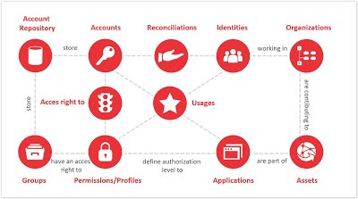

See the subpages for more detail.

### Identities

An identity represents a person who has access to the information system.

Identity information typically comes from HR systems. It can also be consolidated from directories, identity management systems, or other repositories.

Standard available attributes include:

- Identifier
- Alias
- First name
- Middle name
- Last name
- Alternative name
- Full name
- Email
- Arrival date
- Departure date
- Internal

### Organizations

Organizations can be arranged in hierarchies by linking each organization to a parent organization. The model supports multiple hierarchies.

Identities can be linked to organizational nodes, such as senior management or departments. Each assignment includes an occupation that describes the person's role within that organization. Organization data typically comes from HR systems, directories, or identity management systems.

#### Modelling of Organizations

The organizational model includes:

- Organization: An organizational unit. The organizational nodes may be arranged in a hierarchical, tree-like format, with the Board of Directors at the top, followed by department heads such as the Directors of Operations, Administration, and Finance, and their respective subordinate units.
- Occupation: An identity's role within an organization.
- Organization manager: An identity responsible for an organization within a specified area of responsibility.
- Manager: A direct managerial relationship between identities.

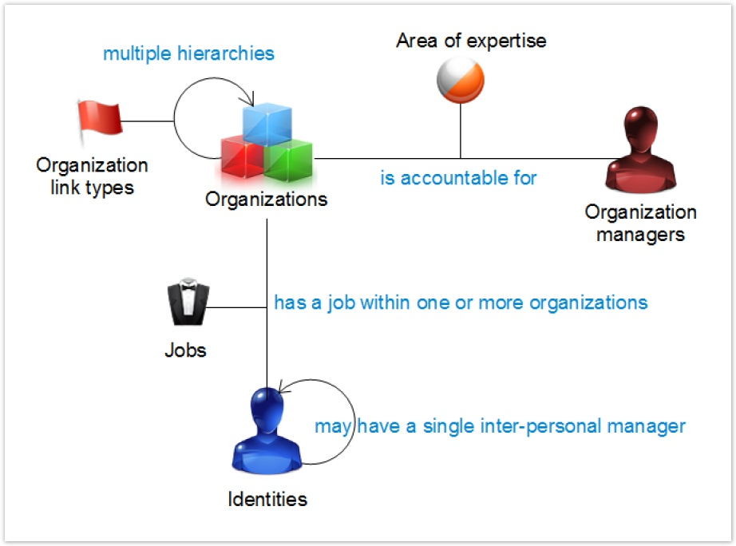

Relationships include a type or qualifying value that allows multiple assignments:

- Organization relationships specify how two organizations are related. For example, a business unit can report hierarchically to one organization and legally to another.
- Occupation assignments link an identity, an organization, and an occupation. For example, a person can be head of geriatrics in one department and a physician in the emergency department.
- Organization management assignments link a manager, an organization, and an area of responsibility. An organization can have multiple managers with different responsibilities.
- Direct managerial relationships identify a person's manager independently of organizational management assignments.

The model supports multiple assignments by using **typed relationships**. These are ternary relationships: each link connects two entities and includes a third element that describes the relationship, such as a relationship type, occupation, or field of competence.

- Relationships between organizational nodes must include a relationship type, such as hierarchical, legal, or center of competence. These types distinguish the relationships between nodes and allow a node to have multiple relationships of different types. For example, a business unit can report hierarchically to organization A while belonging legally to organization B. Organizational nodes can also have types, such as management, section, or department, to support targeted analysis. Together, these capabilities support both simple hierarchical structures and matrix organizations with multiple, potentially overlapping hierarchies.

- Assignments of identities to organizational nodes must include an occupation that describes the person's work within that organization. For example, a person in a hospital can be both head of geriatrics and a doctor in the emergency department. An identity can therefore hold multiple occupations across different organizations and belong to more than one organization.

- Assignments of organization managers must include a field of competence that defines the scope of each manager's responsibility. An organizational node can have multiple managers, each responsible for a different field of competence. Similarly, an identity can manage multiple organizations.

- Direct managerial relationships can also be defined between identities. An identity can have multiple managers through its organizational assignments. This capability is particularly useful in matrix organizations, where a person's assignments may involve different reporting relationships.

> [!warning]
> During data collection, you must specify an occupation when assigning an identity to an organizational node. Otherwise, the assignment is not created. If the occupation is unknown, create and use a default occupation named "Unknown".

* When creating a relationship between organizational nodes, you must specify a relationship type. Otherwise, the relationship is not created.
* When assigning an organization manager, you must specify a field of competence. Otherwise, the assignment is not created.
* Relationship types, occupations, and fields of competence are defined in nomenclature tables. Their values must be populated in the Ledger through the "Nomenclature" collection target, using the dedicated Discovery action.

Standard attributes include:

- Code
- Short name
- Display name
- Type of organization

### Accounts

An account provides access to an information system. It typically includes a login identifier and an authentication method, such as a password.

Identities use accounts to perform operations in applications according to the permissions granted to those accounts.

Account information comes from applications, such as SAP, or infrastructure repositories, such as Active Directory or RACF.

Standard attributes include:

- Key
- Login
- Profile
- First name
- Last name
- Full name
- Email
- Account owner identifier
- Creation date
- Last login date
- Last password change date
- Expiration date
- Service account
- Account deactivated
- Account blocked
- Login count
- Incorrect password count
- Password optional
- Password changeable
- Non-standard account
- Password not expired
- Password expired
- Smart card required

### Applications

An application represents a system or resource in which identities perform operations.

Examples include:

- Business applications, such as SAP or an HR application
- Microsoft Exchange
- File servers and shared directories
- SharePoint
- Physical access control systems
- Servers

Any resource that allows identities to interact through permissions can be modeled as an application in the Ledger.

Application information is usually declared explicitly. It can also be extracted from infrastructure repositories that manage application access.

Standard attributes include:

- Key
- Display name
- Type

### Permissions

A permission represents an access capability within an application.

The appropriate level of detail depends on the purpose of the analysis. Permissions can represent application profiles, transactions, shared directories, SharePoint nodes, or physical access categories.

Permission information comes from applications or infrastructure repositories that manage application access.

#### Choosing the permission level

Load permissions at the level required for the intended control or audit.

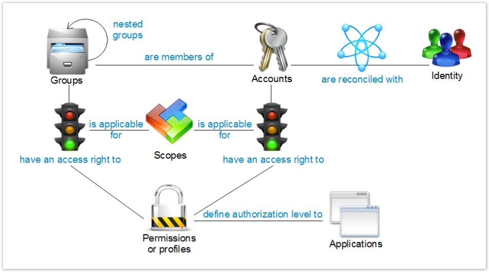

For example:

- To review SAP profiles, load composite and single roles as permissions.
- To analyze segregation of duties in SAP, load individual transactions as permissions.
- To analyze access to shared directories, load the directories as permissions rather than only the Active Directory groups used in their access control lists.

Identity Analytics resolves indirect access paths so that permissions can be analyzed consistently. Permission types allow related permissions to be grouped for analysis and reporting, such as profiles, transactions, or physical access.

#### Linking permissions to accounts

A permission describes an access capability. A right describes an account's specific access to that capability.

Examples:

- Account `ABC` has the `Read Only` right to the shared directory `\share\COMEX`.
- Account `ABC` has the right to use the SAP transaction `PAYMENT` for amounts below $10,000.

A right can also include a perimeter that limits its scope. For example, an account might be authorized to perform trading operations only in Europe and Africa.

An account can receive a permission:

1. Directly.
2. Through a group, including nested group membership.

Groups can represent application groups, roles, or nested profiles. A group can grant access to permissions associated with different repositories.

After accounts are reconciled with identities, Identity Analytics can determine which people have access to which applications and with which privileges.

Standard permission attributes include:

- Key
- Display name
- Type

### Rights

A right links an account to a permission and describes the conditions under which the account can use it.

For example:

- A payment transaction permission can have a maximum authorized amount.
- A shared directory permission can provide read-only access.
- A payment permission can be restricted to the SEPA region through a perimeter.

Rights therefore describe both the permitted action and any associated constraints or scope.

Right information comes from applications or infrastructure repositories that manage application access.

Standard attributes include:

- Display name
- Action
- Limit
- Perimeter

### Repositories

A repository represents a system that stores accounts and groups.

Examples include Active Directory, RACF, Top Secret, and application-specific account stores such as SAP.

Repositories provide a technical view of the information system. They support technical controls, data quality checks, and account reconciliation configuration.

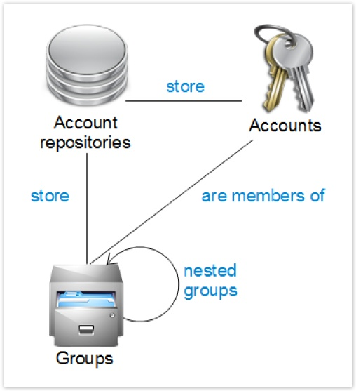

Several applications can use the same repository when they delegate account management to a shared system, such as Active Directory. Applications that manage their own accounts typically have a dedicated repository.

Groups can be nested. These relationships form a directed acyclic graph.

Repository information comes from applications or infrastructure systems.

Standard attributes include:

- Key
- Display name
- Media name
- Extraction date
- Repository type

### Groups

A group combines accounts and can link them to permissions.

Examples include Active Directory groups and SAP composite or single roles.

A group is not restricted to accounts from a single repository. It can contain accounts from multiple repositories.

Group information comes from applications or infrastructure repositories.

Standard attributes include:

- Key
- Display name
- Comments
- Group type
- Creation date
- Modification date

### Assets

The asset concept is based on ISO 27005 and connects business processes with the organizations and technical resources that support them.

An asset can be linked to:

- Organizations responsible for the process
- Permissions that support the process
- Identities designated as asset managers

Assets can be organized into categories and used in reports and summary dashboards. Asset information is declared explicitly or collected from IT service management systems, such as a configuration management database (CMDB).

#### Modeling applications and assets

Assets connect business processes to the organizations and technical resources that support them.

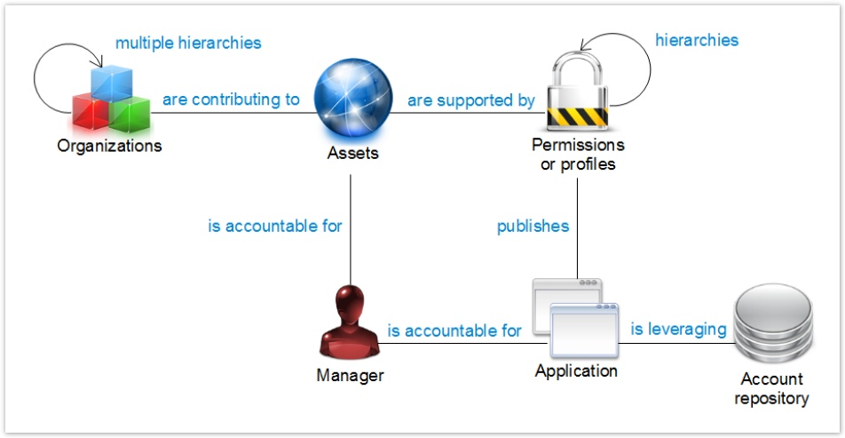

Applications reference repositories, which typically store the accounts used to access those applications. Permissions belong to applications.

Permissions can have hierarchical relationships, such as directory trees or SharePoint structures. More complex access relationships, such as nested roles and transaction profiles, are modeled through groups.

The `applicationtype` attribute distinguishes application categories for analysis and reporting. Example values include:

- `Profile`
- `Filesystem`
- `Physicalaccess`

This attribute accepts free text, so additional application types can be defined.

Standard asset attributes include:

- Code
- Display name
- Category

#### Collecting assets

Asset collection uses three targets:

- [Asset target](igrc-platform/collector/components/targets/asset-target/asset-target.md)
- [Support target](igrc-platform/collector/components/targets/support-target/support-target.md)
- [Actor target](igrc-platform/collector/components/targets/actor-target/actor-target.md)

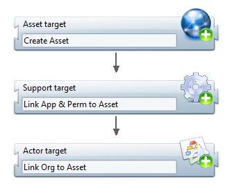

### Reconciliation

To successfully complete the controls, it is necessary to associate users with their corresponding access rights within the Information System. This requires identifying the accounts to which each individual has access. This process of linking accounts to user identities is known as reconciliation. Reconciliation information is derived from the available data according to predefined reconciliation rules. The parameters governing these rules are configured within Identity Analytics.

### Usage

The concepts described above make it possible to model the organization’s structure and the permissions granted to various supporting assets. The concept of usage refers to the consolidation and analysis of access logs. This enables the Ledger to provide both permission-related information (i.e., “this person has access to…”) and activity-related information (i.e., “this person has accessed…”). This information is derived from access logs collected from applications and systems.

#### Modeling usage

Identity Analytics periodically consolidates identity and access information in the Ledger. Access logs can be loaded alongside this information.

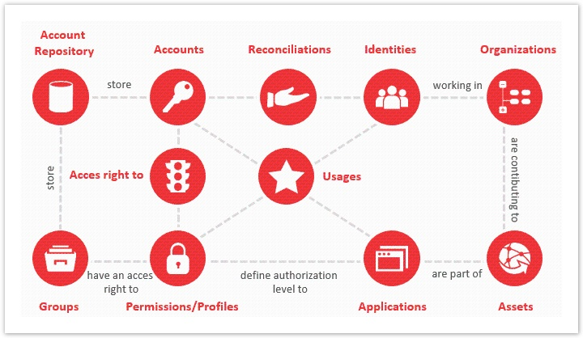

Depending on the available log details, usage can be linked to:

- The account
- The permission used
- The application accessed
- The identity associated with the account

Combining usage information with authorization data supports analysis of:

- Unused accounts, permissions, and applications
- Access to sensitive resources
- Unusual access times or locations
- Access without the corresponding permission
- Repeated access failures

#### Aggregating usage

Identity Analytics aggregates access logs according to categories defined in the configuration, such as:

- Access allowed or denied
- Time slot
- Remote or local access
- Data category accessed

Rather than storing each raw log entry, the Ledger stores usage records containing:

- An account
- An identity
- A permission
- An application
- An aggregation key
- An occurrence count for the collection interval

The occurrence count can be calculated by Identity Analytics or supplied as a pre-aggregated value.

Usage data is consolidated from the log files provided during data loading.

Standard attributes include:

- Display name
- Aggregation key
- Aggregation start date: The earliest event date included in the usage record
- Aggregation end date: The latest event date included in the usage record
- Usage count

## Recommended data loading order

When configuring the data, it is recommended to follow a specific sequence for loading the different data categories. This helps establish relationships between the various data sets and facilitates their integration. The recommended sequence is illustrated in the following diagram:

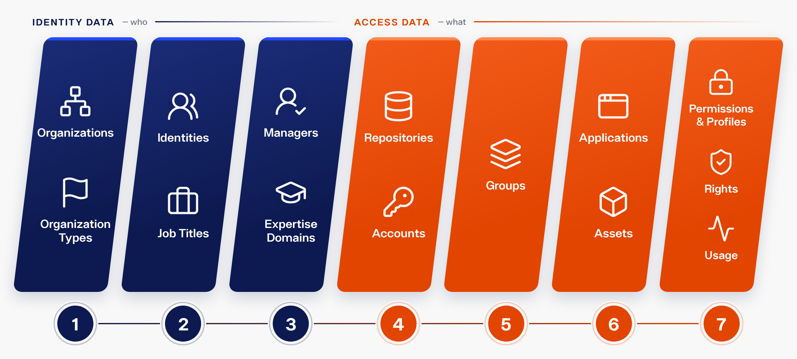

| **Concept**                  | **Description**                                                                   | **Graphical representation**                                                         |
| ---------------------------- | --------------------------------------------------------------------------------- | ------------------------------------------------------------------------------------ |
| Organization                 | Organizations and relationships between organizational units                      | 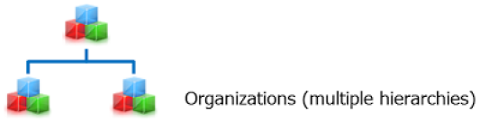 |
| Identities                   | Identities, occupations, organizational assignments, and organization managers    | 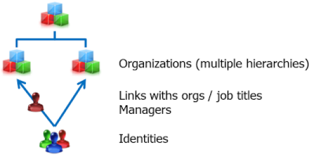                                           |
| Accounts                     | Repositories, accounts, groups, account memberships, and nested group memberships | 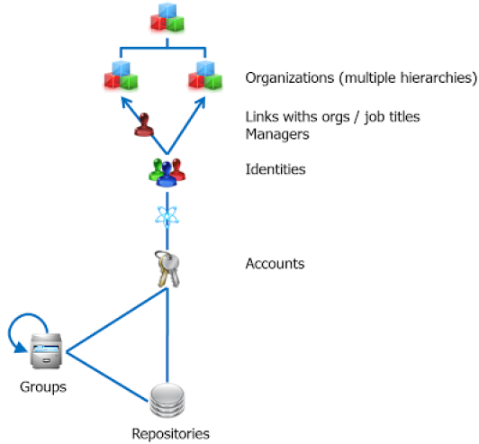                                               |
| Applications and permissions | Applications, permissions, and rights linking permissions to accounts or groups   | 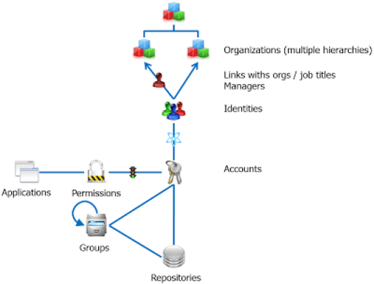       |
| Usage                        | Access log data                                                                   | 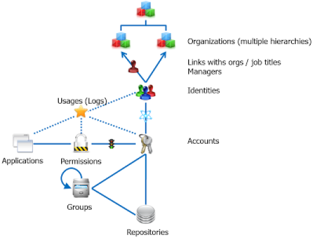                                                     |
| Assets                       | Assets and their relationships                                                    | 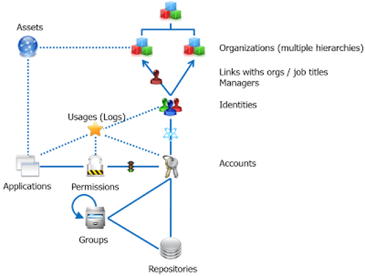                                                   |

Repeat the account-loading and application-loading stages when adding applications to the Ledger.

## Extending the data model

The data model standardizes users' permissions to support consistent analysis and reporting. Its database relationship cardinalities cannot be changed.

However, you can extend each concept by:

- Adding project-specific attributes
- Creating custom nomenclatures and linking them to concepts

## Time management in the data model

### General principles

Access controls, audits, and oversight require visibility into organizational and access changes, including:

- Employee arrivals, departures, and transfers
- Account creation, modification, and reactivation
- Changes to permissions and rights

Between reviews, changes can create inconsistencies between a person's organizational assignments and their access to information systems. Highlighting these changes helps identify new risks and focus remediation efforts.

Change-based analysis is particularly useful for large datasets. Once a stable baseline is established, reviewing changes is more efficient than repeating a full review and validation of all data.

Identity Analytics uses a discrete-time model. It captures a complete snapshot of the collected information at regular intervals, such as weekly, and uses these snapshots for analysis.

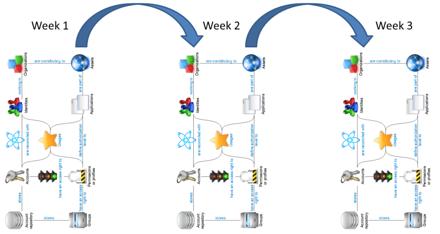

This approach provides two main benefits:

- Historical analysis: Identity Analytics retains complete snapshots, allowing you to analyze the information as it existed at a particular point in time. Combined with security information and event management (SIEM) tools, this supports forensic investigations by providing context, such as a person's department, application access, or directory write permissions at the time of an event.
- Change detection from full extracts: Source systems do not need to provide a list of changes. Identity Analytics compares complete data extracts to identify changes between snapshots. For example, weekly HR extracts can reveal employee arrivals, departures, and organizational transfers.

### Loading complete snapshots

Each snapshot is processed independently in the Ledger and contains the complete set of organizational, identity, account, and access information for that collection. You must therefore provide the full dataset for each load.

The Ledger records the date and time of the source data. If a current source file is unavailable, use the most recent available file to complete the load. Be aware that older data can produce inconsistencies in the analysis, such as failing to identify a recent departure.

During each data load, Identity Analytics:

- Matches newly loaded items to previously loaded items in the Ledger
- Carries forward account reconciliation information
- Identifies organizational changes and changes to right assignments

Dedicated attributes in the data model expose this information for analysis and reporting.

### Handling departures

When a person leaves the organization, exclude the corresponding identity from subsequent data loads. This can happen in either of the following ways:

- The identity is no longer included in the HR extract.
- Collection rules filter out the identity based on its departure date.

Identity Analytics detects the missing identity, updates its status in the Ledger, and changes all accounts previously associated with that identity to `reconciled without owner`, with the following details:

- Reason: `leave`
- Description: The former owner's full name

### Item instances across snapshots

The Ledger stores a separate instance of an item in each snapshot in which it appears.

For example, if an identity is included in 52 weekly snapshots, the Ledger contains 52 instances of that identity—one per snapshot.

### Time-related attributes

#### Item identifiers

Each data model item has two identifiers:

- `recorduid`: Uniquely identifies an item instance in the Ledger. Each snapshot instance of the same entity has a different `recorduid`. This identifier also supports relationships between items within a snapshot. Use it in reports that reference an item in a specific snapshot.
- `uid`: Identifies the same entity across snapshots. Identity Analytics assigns this value when the entity first appears and retains it in subsequent snapshots. Use it in reports that track an entity over time, such as historical reports and trend charts.

For example, an identity named John Doe retains the same `uid` across snapshots, but each snapshot instance has a different `recorduid`.

#### New, updated, unchanged, and deleted items

The Ledger includes attributes that identify whether an item has been created, updated, left unchanged, or deleted.

##### `importaction`

The `importaction` attribute indicates whether an item is new, updated, or unchanged compared with the previous data load.

| Value | Meaning |
| --- | --- |
| `C` | Created: The item appears for the first time and receives a new `uid`. |
| `U` | Updated: One or more of the item's attributes have changed. |
| `N` | None: The item's attributes are unchanged. |

Use `importaction` to filter reports, such as a report listing identities first loaded after a specified date.

This attribute tracks changes to item attributes, not relationships. For example, an account that receives an additional permission can retain the value `N` if none of its own attributes, such as its last login date, have changed.

##### `deletedaction`

The Boolean attribute `deletedaction` indicates whether an item is absent from the next snapshot. For example, it can identify an employee who no longer appears in the HR extract or an account that has been deleted.

Use this attribute in reports that highlight departures and deletions.

> [!NOTE]
> `deletedaction` is populated for a snapshot only after a newer snapshot has been loaded and validated. Reports using this attribute therefore depend on information from the following snapshot. Make this timing clear when presenting the results.

#### Identity change attributes

Identity Analytics automatically calculates the following Boolean attributes during each data load by comparing an identity's relationships with those in the previous snapshot.

| Attribute | Description |
| --- | --- |
| `allocationchanged` | Indicates whether the identity's occupation or organizational assignments have changed. |
| `organisationchanged` | Indicates whether the identity's organizational assignments have changed. Changes to occupations alone do not affect this attribute. |
| `accountchanged` | Indicates whether the identity's associated accounts have changed, including newly reconciled accounts, deleted accounts, and account deactivations or reactivations. |
| `permissionchanged` | Indicates whether the identity's permissions have changed through its reconciled accounts. The calculation considers account deactivation status and includes only reconciled accounts classified as "asset" accounts. |

For `permissionchanged`, Identity Analytics filters out changes caused only by inherited rights within permission hierarchies.

For example, if an identity already has access to a directory, adding a file beneath that directory does not, by itself, set `permissionchanged` to `true`.

#### Account change attributes

Identity Analytics automatically calculates the following Boolean attributes during each data load by comparing an account's relationships with those in the previous snapshot.

| Attribute | Description |
| --- | --- |
| `permissionchanged` | Indicates whether the account's permissions have changed. |
| `groupchanged` | Indicates whether the account's direct group memberships have changed. Changes to nested group relationships alone do not set this attribute to `true`. |

For account-level `permissionchanged`, Identity Analytics also filters out changes caused only by inherited rights within permission hierarchies.

For example, if an account already has access to a directory, adding a file beneath that directory does not, by itself, set `permissionchanged` to `true`.
