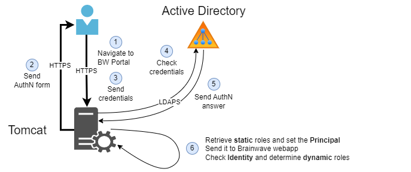

# LDAP Access

Identity Analytics's Web Portal relies on the security of the underlying web application server. Tomcat is exposed to end users but relies on one or multiple LDAP repositories for authentication and authorization.

This guide explains how to use an **LDAP Directory** for user authentication and authorization by using the following features:

- **AuthN**: LDAP Directory authentication (login + password)  
- **AuthZ**: Role retrieval (direct LDAP groups considered as user roles)


## Architecture



Tomcat uses a **Realm** to process authentication with the LDAP Directory via LDAP requests. The standard Tomcat feature for this is called **JNDIRealm**.

- [Tomcat 9.0 JNDIRealm Documentation](https://tomcat.apache.org/tomcat-9.0-doc/realm-howto.html#JNDIRealm)
- [Tomcat 11.0 JNDIRealm Documentation](https://tomcat.apache.org/tomcat-11.0-doc/realm-howto.html#JNDIRealm)

This architecture works on Windows and Linux with:

- Tomcat 9.0, lines **4.x** (recommended) and **3.x** (not recommended)
- Tomcat 11.0, line **5.x** (recommended)


## Prerequisites

These libraries are not available for direct download. Contact Professional Services or Support to obtain the files for your Tomcat and Java versions.

`RoleMappingRealm` (`com.brainwave.tomcat.realm.RoleMappingRealm`) is the Identity Analytics library used with `JNDIRealm`.

**4.x (recommended)** — Tomcat 9.0. These modules run on Java 8, and on Java 17.

- `tomcat-addons-realm-role-mapping-4.x.x.jar`
- `tomcat-addons-realm-base-4.x.x.jar`
- `tomcat-addons-common-4.x.x.jar`

**5.x (recommended)** — Tomcat 11.0 (Jakarta). Java 21 or later. Same JARs, with the `5.x.x` version:

- `tomcat-addons-realm-role-mapping-5.x.x.jar`
- `tomcat-addons-realm-base-5.x.x.jar`
- `tomcat-addons-common-5.x.x.jar`

**3.x (not recommended)** — Tomcat 9.0. One JAR contains every add-on:

- Java 8: `bw-tomcat-9.0-addons.java1.8-3.x.x.jar`
- Java 17 or later: `bw-tomcat-9.0-addons.java17-3.x.x.jar`

**Assumptions:**
- Tomcat is installed and available
- Operator has **read/write privileges** on necessary files and folders to proceed with installation
- Server hosting Tomcat can access LDAP/LDAPS ports (389 / 636)


## Configuration variables

The following variables will be used for configuration:

|         Variable         |                                                 Description                                                 |          Example value          |
| :----------------------: | :---------------------------------------------------------------------------------------------------------: | :-----------------------------: |
| `TOMCAT_INSTALL_FOLDER`  |                                       Tomcat installation root folder                                       |          /etc/tomcat9/          |
|   `TOMCAT_CONF_FOLDER`   |                               Folder that contains Tomcat configuration files                               |        /etc/tomcat9/conf        |
| `TOMCAT_LIB_FOLDER_HOME` |                            Folder that contains all the libraries used by the Tomcat                            |     /usr/share/tomcat9/lib      |
|      `LDAP_BW_LIB`       | Identity Analytics JARs for `RoleMappingRealm`. See the prerequisites for the file names. | tomcat-addons-realm-role-mapping-4.x.x.jar, tomcat-addons-realm-base-4.x.x.jar, tomcat-addons-common-4.x.x.jar |
| `LDAP_ROLE_MAPPING_FILE` |                        File that contains mapping between AD groups and Portal roles                        |     rolemapping.properties      |

### 1. Retrieve LDAP information 

For each LDAP directory (used for **AuthN**), retrieve the following information:

| Property                   | Description                                             | Example                      |
|-----------------------------|---------------------------------------------------------|------------------------------|
| `LDAP name`                | Name of the LDAP directory                        | ACME                         |
| `LDAP URL`                 | LDAP directory URL to be queried                                   | `ldaps://acme.com:636`       |
| `Service account`          |  LDAP service account used to query the LDAP directory. It can be either the `distiguishedName` or the `userPrincipalName`.                                 | `acme\svc-brw-prod`          |
| `Service account password` | Password of the service account used to query the LDAP directory.                              | `***`                        |
| `User base`                | Base entry that has subtree containing users                    | `DC=acme,DC=com`             |
| `User search`              | Expression that defines the criteria for matching user entries.        | `(samAccountName={0})`       |
| `User sub tree`            | The user search scope. Set to true to search the entire subtree starting from the User base entry. The default is false, which limits the search to only the top-level entries.    | `true`                       |
| `Role base`                | The base entry for the role search. If not defined, the top-level directory context is used as the default search base                            | `DC=acme,DC=com`             |
| `Role name`                | Attribute containing identifier of the role                            | `cn`                         |
| `Role sub tree`            |The role search scope. Set to true to search the entire subtree starting from the Role base entry. By default, it is false, limiting the search to only the top-level entries.                                     | `true`                       |
| `Role nested`              | Enable nested roles. Set to true to allow roles to be nested within other roles. When enabled, each discovered Role name and distinguishedName is recursively searched for additional roles. The default is false.                           | `true`                       |
| `Role search`              | The LDAP search filter used to select role entries. It can optionally include pattern replacements: {0} for the distinguished name, {1} for the username, and {2} for an attribute from the authenticated user’s directory entry.        | `(member={0})`               |


For each LDAP directory, if the client chooses to rely on the AuthZ mechanism, you will need to retrieve the following details (example values shown below):

* LDAP name: The name of the LDAP directory. This value is only for identification and does not affect technical files.

* Identity Analytics portal role: The role assigned within the Identity Analytics application. The four roles shown in the earlier table are the standard IAP roles.

* LDAP group: The name of the LDAP group that assigns the corresponding Identity Analytics role to users (used if role authorization is delegated to LDAP). This value must be the LDAP group attribute returned by the LDAP query, which is chosen in the previous AuthN table under the Role name column (e.g., the cn in our example).


| LDAP name | Identity Analytics portal role | LDAP group      |
| :-------- | :----------------------------- | :-------------- |
| ACME      | user                           | brw-users       |
| ACME      | auditor                        | brw-auditors    |
| ACME      | technical admin                | brw-tech-admins |
| ACME      | functional admin               | brw-func-admins |
| ...       | ...                            | ...             |


### 2. Configure Tomcat


> If you are using Linux, ensure you have an understanding of files and folders rights.

The second step is to configure the LDAP AuthN/AuthZ under the Tomcat:

- Under the `<TOMCAT_LIB_FOLDER_HOME>` folder, add the `<LDAP_BW_LIB>` library

- Open the `<TOMCAT_CONF_FOLDER>/server.xml` file
  - If you find a **UserDatabaseRealm** defined within the **LockOutRealm** section, comment it out.

Next, depending on the number of LDAP realms you want to configure, follow one of the two the configuration steps (single LDAP or multiple LDAP) listed below:

#### Configuration for a single LDAP

Within the <TOMCAT_CONF_FOLDER>/server.xml file, define a JNDI Realm and a RoleMapping Realm to configure the LDAP directory connection. 

```xml
<!-- Use the LockOutRealm to prevent attempts to guess user passwords via a brute-force attack -->
<Realm className="org.apache.catalina.realm.LockOutRealm">
  ...
  <Realm className="com.brainwave.tomcat.realm.RoleMappingRealm" reloadPeriod="0" configurationFile="<LDAP_ROLE_MAPPING_FILE>">
    <!-- This is the Realm to which role mapping is applied. -->
    <Realm
    className="org.apache.catalina.realm.JNDIRealm"
    connectionURL="<LDAP URL>"
    connectionName="<Technical account>"
    connectionPassword="<Technical account password>"
    authentication="simple"
    referrals="follow"
    adCompat="true"

    userBase="<User base>"
    userSearch="<User search>"

    userSubtree="<User sub tree>"
    roleBase="<Role base>"
    roleName="<Role name>"
    roleSubtree="<Role sub tree>"
    roleNested="<Role nested>"
    roleSearch="<Role search>"
    />
  </Realm>
  ...
<!-- End of LockOutRealm section -->
</Realm>
```

> All configuration values should already have been retrieved during the `LDAP information retrieving` section.  

> The **JNDIRealm** must be included within the **RoleMappingRealm**, which in turn must be included within the **LockoutRealm**.  

After completing the realm configurations, the next step is to create the role mapping file:

- In the `<TOMCAT_CONF_FOLDER>` directory:
  - Create a file named `<LDAP_ROLE_MAPPING_FILE>`
  - Populate it based on your context, using the format shown below:

    ```properties
    <LDAP_ROLE1>=<PORTAL_ROLE1>
    <LDAP_ROLE2>=<PORTAL_ROLE2>
    ...
    <LDAP_ROLEn>=<PORTAL_ROLEn>
    ```

> Identity Analytics requires at least the user-specific role to be mapped. For details on other default IAP portal roles, see the [Web Portal Roles](https://developer.radiantlogic.com/ia/iap-2.0/identity-analytics/integration-guide/03-webportal-roles/) article.

#### Configuration for multiple LDAPs

In <TOMCAT_CONF_FOLDER>/server.xml, define as many JNDI and RoleMapping Realms as needed to establish connections with all LDAP directories.

```xml
<!-- Use the LockOutRealm to prevent attempts to guess user passwords via a brute-force attack -->
<Realm className="org.apache.catalina.realm.LockOutRealm">
  ...
  <Realm ClassName="org.apache.catalina.realm.CombinedRealm">
    <!-- First JNDI Realm for first LDAP directory -->
    <Realm
      className="org.apache.catalina.realm.JNDIRealm"
      connectionURL="<LDAP URL>"
      connectionName="<Technical account>"
      connectionPassword="<Technical account password>"
      authentication="simple"
      referrals="follow"
      adCompat="true"

      userBase="<User base>"
      userSearch="<User search>"

      userSubtree="<User sub tree>"
      roleBase="<Role base>"
      roleName="<Role name>"
      roleSubtree="<Role sub tree>"
      roleNested="<Role nested>"
      roleSearch="<Role search>"
    />
    <!-- Second JNDI Realm for second LDAP directory -->
    <Realm
      className="org.apache.catalina.realm.JNDIRealm"
      connectionURL="<LDAP URL>"
      connectionName="<Technical account>"
      connectionPassword="<Technical account password>"
      authentication="simple"
      referrals="follow"
      adCompat="true"

      userBase="<User base>"
      userSearch="<User search>"

      userSubtree="<User sub tree>"
      roleBase="<Role base>"
      roleName="<Role name>"
      roleSubtree="<Role sub tree>"
      roleNested="<Role nested>"
      roleSearch="<Role search>"
    />
    ...
    <!-- Nth JNDI Realm for nth LDAP directory -->
    <Realm
      ClassName="org.apache.catalina.realm.JNDIRealm"
      ...
    />
  </Realm>

  <!-- First Role mapping configuration -->
  <Realm className="com.brainwave.tomcat.realm.RoleMappingRealm" reloadPeriod="0" configurationFile="<LDAP_ROLE_MAPPING_FILE>_1">
  <!-- Second Role mapping configuration -->
  <Realm className="com.brainwave.tomcat.realm.RoleMappingRealm" reloadPeriod="0" configurationFile="<LDAP_ROLE_MAPPING_FILE_2>">
  ...
  <!-- Nth Role mapping configuration -->
  <Realm className="com.brainwave.tomcat.realm.RoleMappingRealm" reloadPeriod="0" configurationFile="<LDAP_ROLE_MAPPING_FILE_N>">
  </Realm>
  ...
<!-- End of LockOutRealm section -->
</Realm>
```

> The **JNDIRealm** must be included within the **CombinedRealm**, which in turn must be included within the **LockoutRealm**. If **RoleMappingRealm** is used, declare those realms outside of the **CombinedRealm**.

After completing the realm configurations, the next step is to create the role mapping file:

- In the `<TOMCAT_CONF_FOLDER>` directory:
  - Create a file named `<LDAP_ROLE_MAPPING_FILE>`
  - Populate it based on your context, using the format shown below:

    ```properties
    <LDAP_ROLE1>=<PORTAL_ROLE1>
    <LDAP_ROLE2>=<PORTAL_ROLE2>
    ...
    <LDAP_ROLEn>=<PORTAL_ROLEn>
    ```

You can create as many mapping files as required by your realms.

> Identity Analytics requires at least the user-specific role to be mapped. For details on other default IAP portal roles, see the [Web Portal Roles](https://developer.radiantlogic.com/ia/iap-2.0/identity-analytics/integration-guide/03-webportal-roles/) article.

### 3. Debug settings

To debug the authentication settings, append the following lines to the end of your `<TOMCAT_CONF_FOLDER>/logging.properties`:

```properties
# Authentication Realm debug
org.apache.catalina.realm.level = ALL
org.apache.catalina.realm.userParentHandlers=true
org.apache.catalina.authenticator.level=ALL
org.apache.catalina.authenticator.userParentHandlers=true
com.brainwave.tomcat.realm.RoleMappingRealm.level = ALL
```

## Examples

### JNDI and RoleMapping realms for one LDAP

```xml
<Realm className="com.brainwave.tomcat.realm.RoleMappingRealm" reloadPeriod="10" configurationFile="mappings_sample_ad_group.properties">
  <Realm
    className="org.apache.catalina.realm.JNDIRealm"
    connectionURL="ldaps://192.168.217.136:636"
    connectionName="tomcat-jndi@demo.local"
    connectionPassword="Password01"
    authentication="simple"
    referrals="follow"
    adCompat="true"

    userBase="dc=demo,dc=local"
    userSearch="(samAccountName={0})"
    userSubtree="true"

    roleBase="dc=demo,dc=local"
    roleName="cn"
    roleSubtree="true"
    roleNested="true"
    roleSearch="(member={0})"
  />
</Realm>
```

### Role mapping

```properties
user = BW_Users
technicaladmin = BW_Managers
```

