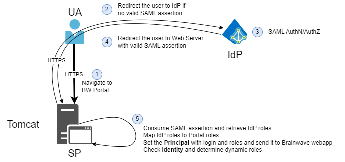
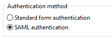

# SAML Access

The SAML authentication mechanism enables the use of a federated identity repository, allowing Tomcat to delegate both authentication and authorization to a third party Identity Provider.

This approach is particularly valuable when an Identity Provider is already deployed within the organization or when the application is intended for use in a cloud-based environment. In such cases, the system relies entirely on the external IdP for identity management.

The Identity Provider does not need to be installed on the Tomcat server itself since it operates as a separate server.

> When authenticating in **federated** mode, the protocol of choice is [SAMLv2](https://wiki.oasis-open.org/security/FrontPage#SAML_V2.0_Standard).

Here is how it works:

- The **User Agent (UA)** is the end user's web browser
- The **Service Provider (SP)** is the Identity Analytics Tomcat web server
- The **Identity Provider (IdP)** is the third party service responsible for authentication and authorization



As you can see here, everything is done through the `HTTP`/`HTTPS` protocol with simple `HTTP redirects` and `HTTP forms`.  
When the user attempts to connect to the service provider, it detects that the user is not authenticated, generates a **challenge** in `SAML` format and redirects the user to the **identity provider** with this challenge.  
The **identity provider** processes the challenge, authenticates the user and redirects the user to the **service provider** with a `response`. The response contains all the required information regarding the user and their **roles**.

The `SAML` challenge/response mechanism involves `XML`, `time stamping` and `XML digital signature` (at a glance, a challenge is sent to the **identity provider**, a response is built by the **identity provider**, it contains the user _identity_, his _roles_, the initial challenge and a validity time frame. The response is **digitally signed** by the identity provider. The response is sent back to the **service provider** which verifies the digital signature, the challenge, the validity time frame and acts accordingly).

Most major vendors, including those listed below, now support the SAMLv2 protocol for user authentication and serve as Identity Providers (IdP):

- Microsoft ADFS
- Google G suite
- Salesforce
- Okta
- InWebo
- LastPass
- OneLogin
- Forgerock
- ...

Identity Analytics provides a SAMLv2 implementation for Tomcat. Use the **4.x** line on Tomcat 9.0 or the **5.x** line on Tomcat 11.0. Both are the recommended lines. The **3.x** line remains available for existing Tomcat 9.0 installations and is not recommended for a new installation. This guide includes the information required to configure SAMLv2 authentication and authorization with a third-party IdP.

This implementation is `SAMLv2` compliant and should be used with **any SAMLv2 compliant identity providers** .

## Configuration procedure

### Step 1: Declare the Identity Analytics application in IdP

First step is to declare your Identity Analytics Web application in order for the IdP to recognize it and perform AuthN/AuthZ process for User Agent request coming from the application.

Here are some samples provided by Identity Analytics:

- [Okta](./okta.md)
- [InWebo](./inwebo.md)
- [G-Suite](./gsuite.md)
- [ADFS](./adfs.md)

> [!warning] These samples are provided as examples. This methodology is not supported by Identity Analytics, but has been tested.

Regardless of the IdP solution you choose, an XML metadata file that represents this SP configuration should be generated and provided by the IdP to be deployed in SP side (more on this later in this document).

### Step 2: Deploy SAML configuration in Tomcat

We will use these variables for the configuration:

|         Variable         |                                      Description                                       |          Example value          |
| :----------------------: | :------------------------------------------------------------------------------------: | :-----------------------------: |
| `TOMCAT_INSTALL_FOLDER`  |                            Tomcat installation root folder                             |          /etc/tomcat9/          |
|   `TOMCAT_CONF_FOLDER`   |                    Folder that contains Tomcat configuration files                     |        /etc/tomcat9/conf        |
| `TOMCAT_LIB_FOLDER_HOME` |                 Folder that contains all libraries used by the Tomcat                  |     /usr/share/tomcat9/lib      |
|    `SAML_BW_ARCHIVE`     |              Third-party SAML libraries archive. Unzip it into the Tomcat `lib` folder.               |   tomcat-addons-saml-libs.zip   |
|      `SAML_BW_LIB`       | Identity Analytics JARs that implement SAML authentication. Copy them into the Tomcat `lib` folder. | tomcat-addons-authenticator-saml-4.x.x.jar and tomcat-addons-common-4.x.x.jar |
| `SAML_ROLE_MAPPING_FILE` |             File that contains mapping between AD groups and Portal roles              |     rolemapping.properties      |
| `SAML_IDP_METADATA_FILE` |                XML IdP configuration metadata file provided by the IdP                 |        idp-metadata.xml         |
| `SAML_SP_METADATA_FILE`  |                           XML SP configuration metadata file                           |         sp-metadata.xml         |
| `SAML_STATIC_ROLE_FILE`  |                            File that contains static roles                             |      staticrole.properties      |
|      `WEBAPP_NAME`       |                             Name of the iGRC Tomcat webapp                             |             sandbox             |
|       `WEBAPP_URI`       |                           Identity Analytics Web Portal URI                            |         /sandbox/portal         |
|       `WEBAPP_URL`       |                           Identity Analytics Web Portal URL                            |     <https://localhost:8080>      |

#### Prerequisites

These libraries are not available for direct download. Contact Professional Services or Support to obtain the files for your Tomcat and Java versions.

**4.x (recommended)** — Tomcat 9.0. SAML requires Java 17 or later.

- `tomcat-addons-authenticator-saml-4.x.x.jar`
- `tomcat-addons-common-4.x.x.jar`
- `tomcat-addons-saml-libs.zip`

**5.x (recommended)** — Tomcat 11.0 (Jakarta). Every module, including SAML, requires Java 21 or later. The feature set is the same as 4.x.

- `tomcat-addons-authenticator-saml-5.x.x.jar`
- `tomcat-addons-common-5.x.x.jar`
- `tomcat-addons-saml-libs.zip`

**3.x (not recommended)** — Tomcat 9.0. Kept for existing installations. One library JAR and one SAML archive:

- Java 8: `bw-tomcat-9.0-addons.java1.8-3.x.x.jar` and `bw-tomcat-9.0-saml-libs-<sdk>.zip`
- Java 17 or later: `bw-tomcat-9.0-addons.java17-3.x.x.jar` and `bw-tomcat-9.0-saml-libs-java17-<sdk>.zip`

`<sdk>` is the SAML library version included in that 3.x package. 4.x and 5.x ship a single `tomcat-addons-saml-libs.zip`. There is no separate Java 8 SAML archive and no `-java17` suffix on those lines.

Ensure the following:

- Tomcat instance is installed and available.
- The operator has RW privileges in needed files and folders to proceed with the installation.

> The SAML stack includes OpenSAML, provided under the Apache License, Version 2.0. 4.x and 5.x use OpenSAML 5. On those lines, SHA-1 signatures are rejected and an authentication request is signed with SHA-256 when `sigAlgo` is not set.

#### Tomcat configuration

> If you are using Linux, be mindful of file and folder permissions.

Deploy the libraries into `<TOMCAT_LIB_FOLDER_HOME>`:

- Copy the JAR files (`<SAML_BW_LIB>`) into this folder.
- Unzip `<SAML_BW_ARCHIVE>` into this folder.
- Create a folder `org/apache/catalina/startup`. In this folder, create an `Authenticators.properties` file with the content below.

```properties
# Licensed to the Apache Software Foundation (ASF) under one or more
# contributor license agreements.  See the NOTICE file distributed with
# this work for additional information regarding copyright ownership.
# The ASF licenses this file to You under the Apache License, Version 2.0
# (the "License"); you may not use this file except in compliance with
# the License.  You may obtain a copy of the License at
#
#     http://www.apache.org/licenses/LICENSE-2.0
#
# Unless required by applicable law or agreed to in writing, software
# distributed under the License is distributed on an "AS IS" BASIS,
# WITHOUT WARRANTIES OR CONDITIONS OF ANY KIND, either express or implied.
# See the License for the specific language governing permissions and
# limitations under the License.

BASIC=org.apache.catalina.authenticator.BasicAuthenticator
CLIENT-CERT=org.apache.catalina.authenticator.SSLAuthenticator
DIGEST=org.apache.catalina.authenticator.DigestAuthenticator
FORM=org.apache.catalina.authenticator.FormAuthenticator
NONE=org.apache.catalina.authenticator.NonLoginAuthenticator
SPNEGO=org.apache.catalina.authenticator.SpnegoAuthenticator
SAML=com.brainwave.tomcat.authenticator.saml.SAMLAuthenticator
```

In `<TOMCAT_CONF_FOLDER>`, create `SAMLAuthenticator.properties`. A complete sample is in [Configuration file samples](#configuration-file-samples). Each property, and the version in which it appeared, is described in [SAML Authenticator properties](./saml-authenticators-properties).

`SAMLAuthenticator.properties` applies to every web application. Since **3.3.10**, and on **4.x** and **5.x**, a web application can use its own file instead: `SAMLAuthenticator-<context-name>.properties`, where `<context-name>` is the context name. That file can point to its own `sp-metadata.xml`. When the context file is absent, `SAMLAuthenticator.properties` is used.

### Step 3: Identity Analytics Portal generation

In your Studio, navigate to the `Export` tab for your project's **technical configuration**:

- Select `SAML authentication`



- Save your technical configuration
- Generate the `<WEBAPP_NAME>` **web portal** using [igrc_portal](../../../02-batch-configuration-and-usage) command line or from the Studio

Once configured, a new `SAML` authentication method is available.

> Note: the SAML method is declared in the `/WEB-INF/web.xml` file under the security configuration in the `auth-method` parameter.

```xml
<login-config>
<auth-method>SAML</auth-method>
</login-config>
```

If you don't setup `SAML` authentication schema from technical configuration, you won't be able to authenticate via `SAML`.

> The `SAML` configuration is declared in the `<TOMCAT_CONF_FOLDER>/SAMLAuthenticator.properties` file configured earlier.

### Step 4: Deploy Identity Analytics Portal

> If you are using Linux, be mindful of file and folder permissions.

Once your `<WEBAPP_NAME>` webapp is generated, the last step is to:

- Copy it to `<TOMCAT_INSTALL_FOLDER>/webapps` folder
- Start the Tomcat.

The portal should be accessible from your browser using `<WEBAPP_URL>/<WEBAPP_URI>`.

## Debug

To activate traces, add the following line at the end of the `/conf/logging.properties`. Do **not** use this in **production**. This is just for troubleshooting `SAML` request/response.

```xml
com.brainwave.tomcat.authenticator.saml.SAMLAuthenticator.level = ALL
```

## Configuration file samples

Place these files in `<TOMCAT_CONF_FOLDER>`. Property meanings and the version in which each property appeared are in [SAML Authenticator properties](./saml-authenticators-properties).

### SAMLAuthenticator.properties

```properties
# SAML Authenticator property file

idpMetadata=idp-metadata.xml
spMetadata=sp-metadata.xml
roleMapping=rolemapping.properties
defaultRoleList=user
staticRole=staticroles.properties
checkRealm=false
roleAttribute=groups
genericUsers=user
genericUserPattern={login} ({generic})
defaultURI=/sandbox/portal
forceURI=/sandbox/portal

# Optional. SAML attribute used as the login instead of the NameID.
# Available since 2.1, and still available in 3.x, 4.x and 5.x.
# userAttributeIdentifier=

# Keystore used to sign authentication requests. Available since 3.3.7, and in 4.x and 5.x.
# Required when AuthnRequestsSigned or WantAuthnRequestsSigned is true.
# privateKeystore=samlkeystore.p12
# privateKeystorePass=changeit
# privateKeyAlias=privatekey
# privateKeyPass=changeit
# privateKeystoreFormat=PKCS12

# Signature algorithm. Available since 3.3.8.
# On 3.3.8 through 3.3.10 the default is rsa-sha1.
# On 4.x and 5.x the default is rsa-sha256, and SHA-1 is rejected.
# sigAlgo=rsa-sha256
```

### idp-metadata.xml

Replace this sample with the metadata file provided by the Identity Provider.

```xml
<?xml version="1.0" encoding="UTF-8"?>
<md:EntityDescriptor xmlns:md="urn:oasis:names:tc:SAML:2.0:metadata" entityID="https://idp.example.com/saml">
  <md:IDPSSODescriptor WantAuthnRequestsSigned="false" protocolSupportEnumeration="urn:oasis:names:tc:SAML:2.0:protocol">
    <md:KeyDescriptor use="signing">
      <ds:KeyInfo xmlns:ds="http://www.w3.org/2000/09/xmldsig#">
        <ds:X509Data>
          <ds:X509Certificate>REPLACE_WITH_THE_IDP_SIGNING_CERTIFICATE</ds:X509Certificate>
        </ds:X509Data>
      </ds:KeyInfo>
    </md:KeyDescriptor>
    <md:NameIDFormat>urn:oasis:names:tc:SAML:1.1:nameid-format:unspecified</md:NameIDFormat>
    <md:SingleSignOnService Binding="urn:oasis:names:tc:SAML:2.0:bindings:HTTP-POST" Location="https://idp.example.com/sso/saml"/>
    <md:SingleSignOnService Binding="urn:oasis:names:tc:SAML:2.0:bindings:HTTP-Redirect" Location="https://idp.example.com/sso/saml"/>
  </md:IDPSSODescriptor>
</md:EntityDescriptor>
```

### sp-metadata.xml

Update `entityID` and both `Location` values. The path must keep `/logout` and `/acs`, and the application name must match the deployed web application.

```xml
<?xml version="1.0"?>
<md:EntityDescriptor xmlns:md="urn:oasis:names:tc:SAML:2.0:metadata"
                     validUntil="2099-01-19T13:33:05Z"
                     cacheDuration="PT3153600000S"
                     entityID="brainwavesaml">
    <md:SPSSODescriptor AuthnRequestsSigned="false" WantAssertionsSigned="true" protocolSupportEnumeration="urn:oasis:names:tc:SAML:2.0:protocol">
        <md:SingleLogoutService Binding="urn:oasis:names:tc:SAML:2.0:bindings:HTTP-Redirect"
                                Location="http://localhost:9090/sandbox/logout" />
        <md:NameIDFormat>urn:oasis:names:tc:SAML:1.1:nameid-format:unspecified</md:NameIDFormat>
        <md:AssertionConsumerService Binding="urn:oasis:names:tc:SAML:2.0:bindings:HTTP-POST"
                                     Location="http://localhost:9090/sandbox/acs"
                                     index="1" />
    </md:SPSSODescriptor>
</md:EntityDescriptor>
```

`WantAssertionsSigned="true"` requires signed assertions. On 4.x and 5.x, a response is accepted when the response itself is signed or when every assertion is signed. If this attribute is true, assertions must still be signed when the response is signed.

### rolemapping.properties

The left side is the role returned by the Identity Provider. The right side is the portal role.

```properties
Domain Users=user
IGA-Admins=igrc-administrator
```

### staticroles.properties

Optional static roles, in the form `login=role1,role2`. Leave the file empty when it is not used. The property `staticRole` must still name the file.

```properties
jdoe@example.com=user,igrc-administrator
```
