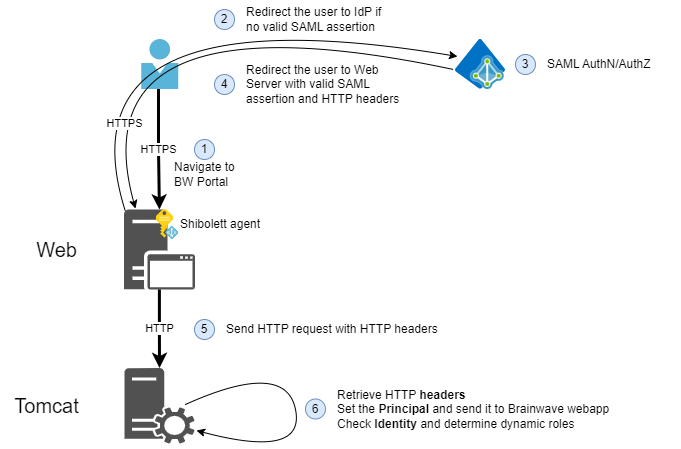
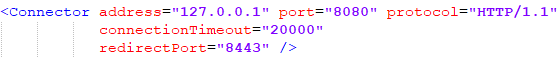

# HTTP Headers Access

This kind of access mechanism is possible when the AuthN/AuthZ process is delegated to an upstream component (a Shibboleth agent deployed in an Apache Web Server for instance).

In this setup, the AuthN/AuthZ module inserts user credential information into the HTTP request headers.

The diagram below illustrates the flow of this type of access:



The following configuration has been validated on Windows and Linux:

- Tomcat 9.0 with the **4.x** line (recommended) or the **3.x** line (not recommended)
- Tomcat 11.0 with the **5.x** line (recommended)


## Pre-requisites

The component that reads the login header, the roles header, and the role mapping is `com.brainwave.tomcat.valve.HttpAuthenticationValve`.

These libraries are not available for direct download. Contact Professional Services or Support to obtain the files for your Tomcat and Java versions.

**4.x (recommended)** — Tomcat 9.0. This valve runs on Java 8, and on Java 17.

- `tomcat-addons-valve-http-authentication-4.x.x.jar`

**5.x (recommended)** — Tomcat 11.0 (Jakarta). Java 21 or later.

- `tomcat-addons-valve-http-authentication-5.x.x.jar`

**3.x (not recommended)** — Tomcat 9.0. The valve is inside the single library JAR:

- Java 8: `bw-tomcat-9.0-addons.java1.8-3.x.x.jar`
- Java 17 or later: `bw-tomcat-9.0-addons.java17-3.x.x.jar`

This valve does not need `tomcat-addons-common`.

Ensure that:

- Tomcat instance is installed and available
- The operator has RW privileges in needed files and folders to proceed to the installation

## Installation

> If you are using Linux, be mindful of files and folders permissions.

Copy the JARs into `<TOMCAT_LIB_FOLDER_HOME>`. The valve reads the user and the roles from HTTP headers and sets the Principal seen by the Identity Analytics web application.

|               Variable                |                                  Description                                   |     Example value      |
| :-----------------------------------: | :----------------------------------------------------------------------------: | :--------------------: |
|         `TOMCAT_CONF_FOLDER`          |                Folder that contains Tomcat configuration files                 |    /etc/tomcat/conf    |
|       `TOMCAT_LIB_FOLDER_HOME`        |             Folder that contains all libraries used by the Tomcat              |  /usr/share/tomcat/lib |
|       `HTTP_HEADER_LOGIN_FIELD`       |               HTTP Header field name that contain the user login               |    samAccountName      |
|      `HTTP_HEADER_MEMBERS_FIELD`      |     HTTP Header field name that contain all AD groups granted to the user      |      isMemberOf        |
| `HTTP_HEADER_MEMBERS_SEPARATOR_FIELD` | Separator character used for user groups list in `<HTTP_HEADER_MEMBERS_FIELD>` |           ;            |
|    `HTTP_HEADER_ROLE_MAPPING_FILE`    |         File that contains mapping between AD groups and Portal roles          | rolemapping.properties |
|             `WEBAPP_NAME`             |                         Name of the iGRC Tomcat webapp                         |        sandbox         |

Follow these steps:

1. Under `<TOMCAT_CONF_FOLDER>`, create `http-header-valve.xml`:

```xml
<config loginHttpHeader="<HTTP_HEADER_LOGIN_FIELD>" rolesHttpHeader="<HTTP_HEADER_MEMBERS_FIELD>" rolesSeparator="<HTTP_HEADER_MEMBERS_SEPARATOR_FIELD>" roleMapping="<HTTP_HEADER_ROLE_MAPPING_FILE>">
    <role>user</role>
</config>
```

Each `<role>` element is a default role added to every authenticated user. The XML file is re-read when it changes. The role-mapping file is re-read about every 10 minutes.

2. Under `<TOMCAT_CONF_FOLDER>`, create `<HTTP_HEADER_ROLE_MAPPING_FILE>`. The left side is the value received in the roles header. The right side is the portal role. A header value with no mapping is kept as-is.

```properties
<SHIBBOLETH_ROLE1>=<PORTAL_ROLE1>
<SHIBBOLETH_ROLE2>=<PORTAL_ROLE2>
```

3. In `<TOMCAT_CONF_FOLDER>/Catalina/localhost/<WEBAPP_NAME>.xml`, declare the valve. `config` is a path relative to the Tomcat `conf` directory.

```xml
<?xml version="1.0" encoding="UTF-8"?>
<Context override="true">
    <Manager pathname="" />
    <Valve className="com.brainwave.tomcat.valve.HttpAuthenticationValve"
           config="http-header-valve.xml" />
</Context>
```

This valve does not use `<auth-method>`.

4. In `server.xml`, if `org.apache.catalina.realm.UserDatabaseRealm` is present and unused, remove it. If that leaves `org.apache.catalina.realm.LockOutRealm` empty, remove the `LockOutRealm` as well.

```xml
<!-- Use the LockOutRealm to prevent attempts to guess user passwords
    via a brute-force attack -->
    <Realm className="org.apache.catalina.realm.LockOutRealm">
    <!-- This Realm uses the UserDatabase configured in the global JNDI
    resources under the key "UserDatabase".  Any edits
    that are performed against this UserDatabase are immediately
    available for use by the Realm.  -->
        <Realm className="org.apache.catalina.realm.UserDatabaseRealm"
        resourceName="UserDatabase"/>
<!-- </Realm> -->
```

## Alternative: HTTPHeaderAuthenticator

`com.brainwave.tomcat.authenticator.HTTPHeaderAuthenticator` only reads the user header. It does not read a roles header and it does not apply `rolemapping.properties`.

- `authorize` set to `true`: the user receives `userDefaultRole` and no Realm is called.
- `authorize` set to `false`: roles come from the configured Realm. A Realm must be configured.

**4.x:** `tomcat-addons-authenticator-http-header-4.x.x.jar` and `tomcat-addons-common-4.x.x.jar`. Java 8 or later.

**5.x:** `tomcat-addons-authenticator-http-header-5.x.x.jar` and `tomcat-addons-common-5.x.x.jar`. Java 21 or later.

**3.x:** the same single JAR as the valve (`bw-tomcat-9.0-addons.java1.8-3.x.x.jar` or `bw-tomcat-9.0-addons.java17-3.x.x.jar`).

```xml
<Valve className="com.brainwave.tomcat.authenticator.HTTPHeaderAuthenticator"
       userRequestHeaderName="samAccountName"
       authorize="true"
       userDefaultRole="user" />
```

The authentication method it reports is `HTTPHeader`.

## Debug

To debug the authentication settings, add the following line at the bottom of `<TOMCAT_CONF_FOLDER>/logging.properties`:

```properties
com.brainwave.tomcat.valve.HttpAuthenticationValve.level = ALL
```

For the authenticator instead of the valve:

```properties
com.brainwave.tomcat.authenticator.HTTPHeaderAuthenticator.level = ALL
```

Once all these steps have been performed, restart Tomcat. Logs should be visible in `catalina` log files.

## Security

Ensure the Tomcat is listening only on localhost and reachable only from Apache for HTTP protocol. You can verify this in the `<TOMCAT_CONF_FOLDER>/server.xml`.


