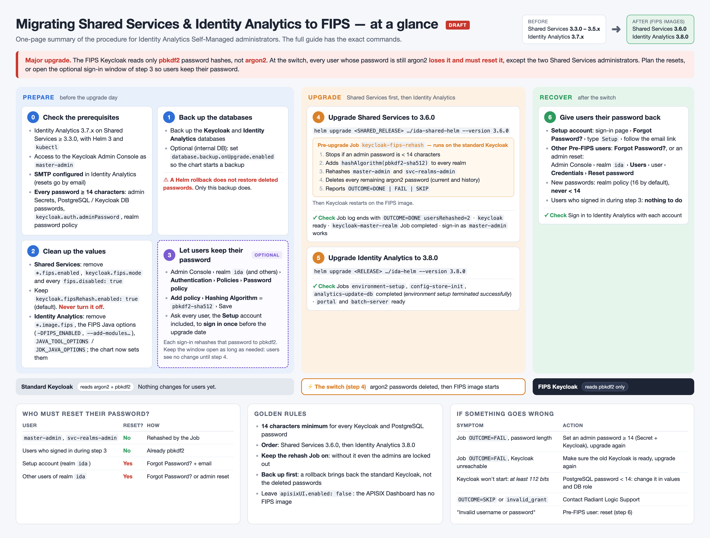
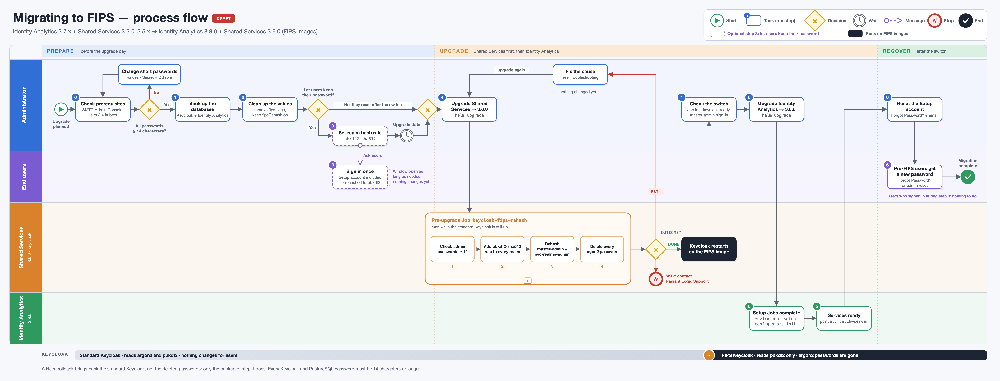

# Migrating Shared Services and Identity Analytics to FIPS

This guide is for the administrators of an Identity Analytics Self-Managed installation. It describes the upgrade from
Identity Analytics 3.7.x on the standard (non-FIPS) Shared Services 3.3.0 to 3.5.x, to Identity Analytics 3.8.0 on
Shared Services 3.6.0, which run FIPS images.

> [!warning]
> **This is a major upgrade.** Shared Services 3.6.0 and Identity Analytics 3.8.0 change the default FIPS support of
> every application: Keycloak, APISIX, etcd, PostgreSQL, the portal, the batch server and the data recovery now run
> FIPS images, whose cryptography uses only FIPS 140-3 validated modules. After the switch, **Keycloak can no longer
> read the passwords stored by the standard Keycloak**: the users who did not sign in during the upgrade lose their
> password and must reset it. Read [Design](#design) and plan the resets before you start. To let users keep their
> passwords, follow the optional [step 3](#3-optional-let-users-keep-their-password).

## Overview

### Versions

| Application | Chart | Before the upgrade | After the upgrade |
|---|---|---|---|
| Shared Services | `ida-shared-helm` | 3.3.0 to 3.5.x (standard Keycloak 26.5.3 or 26.7.4) | 3.6.0 (FIPS Keycloak 26.8.1) |
| Identity Analytics | `ida-helm` | 3.7.x | 3.8.0 |

Shared Services 3.3.0 is the oldest version this upgrade supports. Upgrade Shared Services first, then Identity
Analytics. The FIPS images are required from these versions on: there is no option to stay on the standard images.

### The Identity Analytics realm

The users of Identity Analytics are in one Keycloak realm, named after the Kubernetes namespace where Identity
Analytics is deployed: Identity Analytics deployed in the namespace `ida-prod` uses the realm `ida-prod`. This guide
calls it the **Identity Analytics realm** and writes its name `<NAMESPACE>`.

### At a glance



The summary shows the realm as `ida`: read it as the Identity Analytics realm, `<NAMESPACE>`.

## Design

### Why passwords stop working

The standard Keycloak stores every password hashed with **argon2**. The FIPS Keycloak can verify only **pbkdf2**
hashes. A password stored before the switch, however long, is refused after it.

Keycloak rehashes a password when its owner signs in, with the algorithm of the realm's **hash rule** (the
`hashAlgorithm(...)` clause of the realm's password policy). A user who signs in while the rule is
`hashAlgorithm(pbkdf2-sha512)` and the standard Keycloak still runs keeps their password after the switch.

### What the upgrade does

The Shared Services 3.6.0 upgrade runs a pre-upgrade Job, `keycloak-fips-rehash`, **while the standard Keycloak is
still running**:

1. It stops the upgrade if the password of `master-admin` or `svc-realms-admin` is shorter than 14 characters.
2. It adds the hash rule `hashAlgorithm(pbkdf2-sha512)` to the password policy of every realm, and keeps every other
   rule (length, history, expiry…).
3. It signs in as `master-admin` and `svc-realms-admin`, the two Shared Services administrators, so their passwords
   are rehashed to pbkdf2.
4. It deletes every current and past password stored with argon2. Without that, the FIPS Keycloak could not reset
   them: the password history check fails on a hash it cannot read.
5. It lists, per realm, the users still on a hash the FIPS Keycloak cannot read, and ends with one line
   `CAUSE=… OUTCOME=DONE|FAIL|SKIP … credentialsPurged=<n>`. It never writes a password in its log.

Then Keycloak restarts on the FIPS image. The two administrators sign in as before. **Every other user whose
password was set on the standard Keycloak (a Pre-FIPS user) has no password any more** and signs in again only after
a reset:

| User | How they get a password back |
|---|---|
| `master-admin`, `svc-realms-admin` | Nothing to do: rehashed by the Job |
| Setup account (Identity Analytics realm) | **Forgot Password?** on the sign-in page, then the link in the email |
| Other users of the Identity Analytics realm | **Forgot Password?**, or an admin reset in the Keycloak Admin Console |
| Users who signed in with the hash rule set, before the switch ([step 3](#3-optional-let-users-keep-their-password)) | Nothing to do: their password is already pbkdf2 |

The Job runs again on every later Shared Services upgrade. On a Keycloak already on FIPS it changes nothing and every
password keeps working.

The Identity Analytics 3.8.0 upgrade adds the same hash rule to the Identity Analytics realm if it is missing, and a
new installation creates the realm with it. It does not change the other rules of the policy, nor the stored passwords.

### FIPS password minimum

The FIPS Keycloak refuses any new password shorter than **14 characters**, on top of the realm's own policy. The Identity
Analytics realm already requires 16 characters by default. The same 14-character minimum applies to every password used to
connect to PostgreSQL.

## Prerequisites

- Identity Analytics 3.7.x on Shared Services 3.3.0 or later, deployed with Helm.
- Helm 3, and `kubectl` access to the namespaces of Shared Services (`<SHARED_NAMESPACE>`) and Identity Analytics
  (`<NAMESPACE>`). `<SHARED_RELEASE>` and `<RELEASE>` are the Helm release names.
- Access to the Keycloak Admin Console, `https://<APP_ENDPOINT>/auth/admin/`, as `master-admin`.
- An SMTP server configured in Identity Analytics: the Setup account and the other users get their password back by
  email.
- Every password below is **14 characters or longer**. Change the shorter ones before the upgrade, both in the values
  or Secret and in the database role itself:
  - the Secrets of `master-admin` (`keycloak-master-admin`) and `svc-realms-admin` (`keycloak-svc-admin-credentials`);
  - `database.postgres.password`, `database.keycloak.password`, or `database.external.password` for an external
    database, or the keys of their `existingSecret`;
  - `keycloak.auth.adminPassword`.
- A realm password policy that requires 14 characters or more. A realm set to fewer still locks its users out after a
  reset.

## Procedure



### 1. Back up the databases

The upgrade deletes the passwords the FIPS Keycloak cannot read. A Helm rollback restores the previous charts and
images, **not** the deleted passwords: only a database backup does.

1. **Back up** the Keycloak database and the Identity Analytics database with your usual backup procedure.
2. **Optional**, on the internal database: let the Shared Services chart create a backup before the Job runs. The
   chart starts the backup and does not wait for it to finish.
   ```yaml
   database:
     backup:
       enabled: true
       onUpgrade:
         enabled: true
   ```

### 2. Prepare the values

1. **Remove** from the Shared Services values any `keycloak.fips.enabled`, `bwapisix.fips.enabled` or
   `keycloak.fips.mode`: they are deprecated. Remove also any `fips.disabled: true` (`keycloak`, `bwapisix`, `etcd`,
   `tools.image`, `database.postgres.image`): every component must run its FIPS image.
2. **Leave** `keycloak.fipsRehash.enabled` to its default, `true`. Turning it off skips the Job: every password,
   the administrators' included, then fails after the switch.
3. **Clean up** the Identity Analytics values. From 3.8.0, the chart chooses the FIPS image of each component and sets
   the Java options FIPS needs. A FIPS setting you added by hand in your 3.7.x values either turns FIPS off or
   overrides what the chart sets, so search your values for the settings below and delete them:

   | Search your values for | Under | Why it goes |
   |---|---|---|
   | `fips:` | `batch.image`, `portal.image`, `dataRecovery.image`, `tools.image` | The chart runs the FIPS image by default. A `fips.disabled: true` there brings back the standard image |
   | `--add-modules=org.bouncycastle.fips.pkix` and `-DFIPS_ENABLED=true` | `portal.javaOptions`, `portal.javaEclipseOptions`, `workflow.javaOptions`, `workflow.javaEclipseOptions` | The chart now adds them itself. Keep the other options of these settings |
   | `JAVA_TOOL_OPTIONS` or `JDK_JAVA_OPTIONS` | the `env` map of a component (`batch.env`, `portal.env`, `workflow.env`) | They would replace the Java options of the FIPS image. The chart drops them and warns. Move any other flag they hold to the component's `javaOptions` |
   | `-Dorg.bouncycastle.rsa.allow_multi_use` | any Java option | No longer needed |

   For example, a portal set up by hand for FIPS on 3.7.x:
   ```yaml
   portal:
     javaOptions: "-Dmy.option=value --add-modules=org.bouncycastle.fips.pkix -DFIPS_ENABLED=true"
   ```
   keeps only its own option on 3.8.0:
   ```yaml
   portal:
     javaOptions: "-Dmy.option=value"
   ```
   If your values have none of these settings, there is nothing to change.

### 3. Optional: let users keep their password

Without this step, every user except the two Shared Services administrators must reset their password after the
switch. With it, the users who sign in during a window you choose keep their password.

The principle: set the hash rule on the standard Keycloak, before the Shared Services upgrade. Each user who then
signs in has their password rehashed to pbkdf2 by Keycloak, which the FIPS Keycloak can read. The passwords themselves
do not change.

1. **Open** the Keycloak Admin Console as `master-admin`.
2. For each realm whose users must keep their password (at least the Identity Analytics realm, `<NAMESPACE>`):
   1. **Select** the realm, then **Authentication** > **Policies** > **Password policy**.
   2. **Click** **Add policy** and choose **Hashing Algorithm**.
   3. **Type** `pbkdf2-sha512` and **click** **Save**.

   The policy keeps its other rules, with **Hashing Algorithm** `pbkdf2-sha512` added. The stored passwords are not
   changed yet.
3. **Ask** the users to sign in to Identity Analytics once, the Setup account included, before the date of the
   upgrade. Each successful sign-in moves that user's password to pbkdf2-sha512. A user who changes their password in
   this window also gets a pbkdf2 password.
4. **Optional**, on the internal database: list the users still on argon2, who will need a reset after the switch.
   The query reads only the name of the algorithm, never the password data.
   ```bash
   kubectl --namespace <SHARED_NAMESPACE> exec -i keycloak-db-1 -c postgres -- \
     psql -U postgres -d keycloak_db -c "select r.name realm, u.username, c.credential_data::json->>'algorithm' algorithm
       from keycloak.credential c
       join keycloak.user_entity u on u.id = c.user_id
       join keycloak.realm r on r.id = u.realm_id
       where c.type = 'password' order by 1, 2"
   ```
   A user shown with `argon2` has not signed in since the rule was set.

Keep the window open as long as you need: the standard Keycloak verifies both argon2 and pbkdf2, so nothing changes
for the users until the Shared Services upgrade.

### 4. Upgrade Shared Services to 3.6.0

1. **Run** the upgrade:
   ```bash
   helm upgrade <SHARED_RELEASE> oci://registry-1.docker.io/radiantone/ida-shared-helm \
     --version 3.6.0 --namespace <SHARED_NAMESPACE> --values <shared-values.yaml>
   ```
   The `keycloak-fips-rehash` Job runs first, then Keycloak restarts on the FIPS image.
2. **Check the logs** of the `keycloak-fips-rehash` Job. A successful run shows:
   - `passwordPolicy updated to include pbkdf2-sha512` for each realm, or `already uses` when the rule was set in
     [step 3](#3-optional-let-users-keep-their-password);
   - `argon2 -> pbkdf2-sha512` for `master-admin` and `svc-realms-admin`;
   - one `purged password algorithm=argon2` line per Pre-FIPS user;
   - a last line `CAUSE=none OUTCOME=DONE usersRehashed=2 … credentialsPurged=<n>`.

   On `OUTCOME=FAIL` the upgrade has stopped and nothing changed: see [Troubleshooting](#troubleshooting).
3. **Check** that the `keycloak` service is running and ready, and that the `keycloak-master-realm` Job completed.
4. **Sign in** to the Keycloak Admin Console as `master-admin`. The console opens with the unchanged password.

### 5. Upgrade Identity Analytics to 3.8.0

1. **Run** the upgrade:
   ```bash
   helm upgrade <RELEASE> oci://registry-1.docker.io/radiantone/ida-helm \
     --version 3.8.0 --namespace <NAMESPACE> --values <ida-values.yaml>
   ```
2. **Check** that the `environment-setup`, `config-store-init` and `analytics-update-db` Jobs completed. The logs of
   `environment-setup` end with `environment setup terminated successfully`.
3. **Check** that the `portal` and `batch-server` services are running and ready.

### 6. Give the users their password back

1. **Setup account**: on the Identity Analytics sign-in page, **click** **Forgot Password?**, type `Setup`, then open
   the link of the email and set the password. The previous password is accepted again: the upgrade deleted the old
   password history.
2. **Other Pre-FIPS users**: either they use **Forgot Password?** the same way, or a Keycloak administrator resets
   them:
   1. In the Keycloak Admin Console, **select** the Identity Analytics realm, `<NAMESPACE>`, then **Users** and the user.
   2. **Open** the **Credentials** tab and **click** **Reset password**.
   3. **Type** a password that meets the realm policy (16 characters by default, never fewer than 14) and **save**.

   Leave the realm's password history rule on: the reset works with it.
3. **Sign in** to Identity Analytics with each account. Users who signed in during
   [step 3](#3-optional-let-users-keep-their-password) sign in with their usual password and need nothing else.

## Going back

A Helm rollback of Shared Services restores the standard Keycloak, which reads both argon2 and pbkdf2, so the two
administrators and the users who already reset their password still sign in. The passwords the Job deleted are
**not** restored: restore the database backup of [step 1](#1-back-up-the-databases) to get them back.

## Known limitations

- The APISIX Dashboard has no FIPS image. Leave `apisixUI.enabled: false` (default) for an installation with no
  non-FIPS workload.
- A realm created after the Shared Services upgrade gets the hash rule only if the application that creates it writes
  it. Identity Analytics 3.8.0 does so for the Identity Analytics realm.

## Troubleshooting

| Symptom | Likely cause | Action |
|---|---|---|
| Shared Services upgrade stops, Job log `OUTCOME=FAIL` with a password length cause | `master-admin` or `svc-realms-admin` password shorter than 14 characters | Set a 14-character or longer password in the Secret and in Keycloak, then upgrade again |
| Shared Services upgrade stops, Job log `OUTCOME=FAIL`, Keycloak unreachable or sign-in refused | The standard Keycloak was not running or not ready when the Job started | Check that the `keycloak` service is running and ready on the previous version, then upgrade again. Do not turn the Job off |
| Job log `OUTCOME=SKIP` | Keycloak was already on FIPS and the administrators cannot sign in | Contact Radiant Logic Support for the administrator recovery procedure |
| Keycloak does not start, logs show `FipsUnapprovedOperationError: password must be at least 112 bits` | A PostgreSQL password is shorter than 14 characters | Change it in the values and in the database role, then upgrade again |
| `keycloak-master-realm` or `environment-setup` Job fails with `invalid_grant` | The administrators' passwords were not rehashed (Job turned off or skipped) | Contact Radiant Logic Support for the administrator recovery procedure |
| A user gets "Invalid username or password" with their usual password | Pre-FIPS user: the password was deleted at the switch | Forgot-password reset or admin reset ([step 6](#6-give-the-users-their-password-back)) |
| A new password is refused | Shorter than 14 characters, or than the realm's own minimum | Use a longer password |
